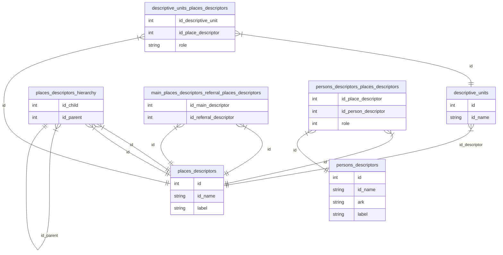

# Dataset
The [dataset](https://github.com/burgerbibliothek/glamhack26/tree/main/data/src/data) consists of seven tables (in the [parquet](https://parquet.apache.org/docs/overview/) format):
- `places_descriptors` contains all available place descriptors (23’501 items).
- `persons_descriptors` contains all available person descriptors (legal entities and natural persons; 21’009 items).
- `descriptive_units` contains descriptive units (88’389 items).
- `descriptive_units_places_descriptors` contains associations between place descriptors and descriptive units.
- `main_places_descriptors_referral_places_descriptors` contains the associations between main descriptors and referral descriptors.
- `persons_descriptors_places_descriptors` contains the associations between place descriptors and person descriptors.
- `places_descriptors_hierarchy` contains the hierarchy of place descriptors.
- `glamhack26.duckdb` all the Parquet files repackaged as DuckDB.


## Table `places_descriptors`
- The column `id` contains the numeric ID for a place descriptor.
- The column `id_name` contains another form of an ID for the place descriptor (e.g. “Bern (BE) (Orte\Sch\Schweiz (CH)\Bern (Kanton)”). In the last outermost pair of parentheses in the id name, the hierarchy can be traced. In the provided example, it's visible, that the place descriptor “Bern (BE)” is a child of the place descriptor “Bern (Kanton)”, which itself is the child of “Schweiz (CH)”, and so on.
- The column `label` contains a label and describes how the place descriptor is called (mostly with a German exonym).

## Table `descriptive_units`
- The column `id` contains the numeric ID for a descriptive unit.
- The column `id_name` contains another form of an ID for a descriptive unit.

## Table `persons_descriptors`
- The column `id` contains the numeric ID for the person descriptor.
- The column `id_name` contains another form of an ID for the person descriptor (e.g. “Bern (Burgergemeinde), Burgerbibliothek (Personen\Juristische Personen\B)”). The id name contains an indication if the descriptor is a legal entity or natural person.
- The column `ark` contains another form of an ID for a descriptive unit.
- The column `label` contains another form of an ID for a descriptive unit.

## Table `descriptive_units_places_descriptors`
- The column `id_descriptive_unit` contains the numeric ID for a descriptive unit.
- The column `id_place_descriptor` contains the numeric ID for a place descriptor.
- The column `role` contains further description for the relation.

## Table `persons_descriptors_places_descriptors`
- The column `id_place_descriptor` contains the numeric ID for place descriptor.
- The column `id_person_descriptor` contains the numeric ID for a person descriptor.
- The column `role` contains further description for the relation (1 = place of birth, 2 = place of death , 3 = place of activity, 4 = place of origin, 5 = place of residence).

## Table `main_places_descriptors_referral_places_descriptors`
This table contains the associations between main descriptors and referral descriptors. Referral descriptors, always point to a main descriptor (e.g. "Arabergass" → "Arabergasse") and are not associated with a descriptive unit.
- The column `id_main_descriptor` contains the ID of a main descriptor.
- The column `id_referral_descriptor` contains the ID of a referral descriptor.

## Table `places_descriptors_hierarchy`
This table contains pairs of place descriptor ids in order to reconstruct their hierarchy (e.g. “Bern (BE)” is a child of the place descriptor “Bern (Kanton)”.
- The column `id_child` contains the id of a place descriptor.
- The column `id_parent` contains the id of a place descriptor.

## Specialties in the dataset
The children of the descriptor (Orte\Sch\Schweiz (CH)\Bern (Kanton)\Bern (BE)\Historisch-Topographisches Lexikon\) are a special kind of place descriptor. They represent lexicon entries from the “[Historisch-topographische Lexikon der Stadt Bern von Berchtold Weber](https://archives-quickaccess.ch/search/bbb/lexikon)”. They do contain some additional data about a place (e.g. [ark:36599/nw00xr4nws1](https://ark.burgerbib.ch/ark:36599/nw00xr4nws1)). The Hist.-topo data has been incorporated in the [bernese city map](https://map.bern.ch/stadtplan/?grundplan=Stadtplan_farbig_Geoportal|Stadtplan_farbig_Extern_Region&koor=2600471,1199698&zoom=3&hl=0&layer=Strassennamen), which is the reason why the entries possess a persistent identifier (ARK). For simplicity, the ARK and additional Hist.-topo. data is not included in the above tables.

# Queries
## Get all descriptors concerning the “Historisch-Topographisches Lexikon”
```SQL
# Table places_descriptors
SELECT id, id_name, regexp_matches(id_name, '\(Orte\\Sch\\Schweiz \(CH\)\\Bern \(Kanton\)\\Bern \(BE\)\\Historisch-Topographisches Lexikon\\[A-Z]\)') AS found
FROM file
WHERE found = true
```

# Aggregated Data
- `osm/*.json` contains the result of calls to the Nominatim API (`fetch-from-nominatim.py`).
- `birth_death_places_geo.csv` contains a list with the geocoordinates of the birth and death place of persons (columns `place_id, role, ark, person_label, lat, long`; `role` 1 = birth, 2 = death; `place_id` = `places_descriptors.id`).

# Person enrichment and reconciliation
The persons of `birth_death_places_geo.csv` (identified by `ark`) were enriched with data from their ARK landing pages and reconciled against authority files. All files are keyed by `person_id`, which is `persons_descriptors.id` (the numeric person descriptor id); `ark` is kept as a second key to join back to `birth_death_places_geo.csv`.

```
birth_death_places_geo.csv ──ark──► enrich_persons.py ──► person_enrichment.csv
                                                              │  split in 3 batches
                                                              ▼
                                    person_enrichment_batches/raw/        (as scraped)
                                                              │  OpenRefine: reconcile against GND / Wikidata, manual check
                                                              ▼
                                    person_enrichment_batches/verified/   (reconciled + verified)
                                                              │
birth_death_places_geo.csv ─┐                                 │  description, matched_entity
fetch_metagrid.py ─► person_metagrid.csv ── hls_link ─────────┤
                            build_map_json.py ◄───────────────┘
                                   │
                                   ▼
                            map_data.json  ──►  web/ (map + arcs)
```

## `enrich_persons.py` → `person_enrichment.csv`
Every ARK resolves (HTTP redirect) to one of two page types: `archives-quickaccess.ch/bbb/person/<id>` (schema.org Person markup, 2,116 of 2,296 persons) or a `katalog.burgerbib.ch/deskriptordetail.aspx?Id=<id>` descriptor page (the other 180; these have no separate name fields, and they include all legal entities). The script fetches and parses both, caches the raw HTML in `ark_cache/` (git-ignored, so it is resumable) and writes one row per person:

| Column | Content |
|---|---|
| `person_id`, `ark` | keys |
| `person_type` | `natural` or `legal`, from the thesaurus path of the descriptor |
| `page_type`, `page_url`, `http_status` | which page the ARK resolved to |
| `given_name`, `family_name` | quickaccess pages only |
| `name` | `LastName, FirstName` for reconciliation. Falls back to the descriptor label without the `(dates)` suffix (catalogue pages, legal entities) |
| `birth_date`, `death_date` | as printed on the page (`12.11.1679` or `1752`) |
| `birth_date_iso`, `death_date_iso`, `birth_year`, `death_year` | parsed; empty if not parseable (e.g. `18. Jh.`) |
| `description` | short biography text of the archive |

Usage: `python enrich_persons.py [--limit N] [--workers 3] [--delay 0.2] [--refresh] [--offline]`. It needs `polars`, `requests`, `beautifulsoup4` and `lxml`.

## Batches and reconciliation
`person_enrichment.csv` (2,296 persons) was split into three contiguous slices by `person_id` (766, 765 and 765 persons) so that several people can work in parallel; they are in `raw/`. The `name` column was reconciled in OpenRefine against GND and Wikidata and the matches were checked manually. The result is in `verified/` with the same columns plus `matched_entity`, the URI of the matched entity. `matched_entity` is empty for persons without a verified match.
- All three batches are in `verified/`, but they are not equally complete: batch 1 has 568 of its 766 persons (all matched), batch 2 has 139 of 765 persons (none with a `matched_entity`) and batch 3 has all 765 persons (671 matched, 94 not). Overall 1,472 of 2,296 persons are in `verified/`, 1,239 of them with a `matched_entity`, mostly GND, then Getty, Wikidata and SIK-ISEA (plus a few ETH-GTA and Library of Congress URIs). The remaining 824 persons are not in any verified file and get `null` in the map data.
- `birth_death_places_geo.csv` is still being extended. To enrich new persons, re-run `enrich_persons.py` (cached pages are not fetched again); the batches in `raw/` are not updated automatically.

## `fetch_metagrid.py` → `person_metagrid.csv`
The ARK pages embed a [Metagrid](https://metagrid.ch) widget that loads its links from `api.metagrid.ch/widget/burgerbibliothek/person/<person_id>.json`, so the links are not in the cached HTML. The script queries that API once per person (responses cached in `metagrid_cache/`, git-ignored) and writes one row per person with `n_links` and one URL column per provider, most frequent first: `gnd`, `helveticat`, `viaf`, `hls` (Historisches Lexikon der Schweiz), `hfls`, `sikart`, `loc`, `bsg`, `sudoc`, ... (36 providers). A 404 from Metagrid means that no links are known for the person. 1,649 of 2,295 persons have at least one link, 801 an `hls` link.

## `build_map_json.py` → `map_data.json`
Generates the JSON for the map and arc visualisation in `web/` (served as `data/src/data/map_data.json`). Usage: `python build_map_json.py [--out PATH] [--keep-suspect]`.

```
meta   counts, filters, generation time
places [{id, label, country, lat, lon, births, deaths, suspect}]       points layer
arcs   [{ark, name, birth_year, death_year, source, target, from, to,   one arc per person
         distance_km, ambiguous, description, matched_entity, hls_link}]
flows  [{source, target, count, distance_km}]                          arcs aggregated by origin and destination
```
- An arc is drawn from the birth place to the death place; `from`/`to` are `[lon, lat]`. Persons with several birth or death places get one arc per pair (`ambiguous`). Persons with only one of the two places appear only in `places`.
- Arcs shorter than 0.5 km are dropped (born and died in the same place).
- `birth_year` and `death_year` are parsed from the person label (`Name (1679-1767)`).
- `description` and `matched_entity` come from `person_enrichment_batches/verified/*.csv` and are `null` for persons without a verified row. `hls_link` comes from `person_metagrid.csv` and is `null` if there is no HLS article.
- Places with a Swiss descriptor but coordinates outside Switzerland (bounding box) are flagged `suspect` and left out of places and arcs (`--keep-suspect` keeps them).

## Analysis notebook
`../notebooks/birth_death_analysis.ipynb` (run with polars, matplotlib and jupyter) describes the data characteristics that led to these choices: only about half of the persons have both a birth and a death place, a few places such as Bern dominate, most arcs are short and Swiss-internal, and about 98% of the arcs have both years.

## Known data issues
- **Geocoding errors:** OSM matched homonyms abroad. [#2](https://github.com/burgerbibliothek/glamhack26/issues/2) (48 Swiss places outside Switzerland, fixed) and [#3](https://github.com/burgerbibliothek/glamhack26/issues/3) (7 foreign places in the wrong country: Worcester (GB), Carlton (GB), Chesterfield (GB), Dornach (F), Tirano (I), Ofen (H), Yoré (F)). The 12 `USA (USA)` places cannot be checked automatically because their OSM matches carry no country code, and a wrong location inside the right country is not detected.
- **Duplicated ARK:** 6 `ark` values in `persons_descriptors.parquet` contain the same URL twice, separated by a space (one of them in the CSV, person 13042). `enrich_persons.py` fetches the first URL and keeps the original value in the `ark` column.
- **Metagrid vs. reconciliation:** for 511 verified persons both Metagrid and the reconciliation provide a GND link. They agree for 440 and differ for 71 (24 in batch 1, e.g. Albert Bitzius, Johann Heinrich Maurer, Samuel Moser; 47 in batch 3, e.g. Johann Jakob Lauffer, Lee Miller, Josef Zemp). These should be checked manually.
- **Dates:** `birth_date`/`death_date` are empty for about 8% of the persons and some are only a century (`18. Jh.`), so they have no `*_iso` value.

# Tools
- [ParquetViewer](https://parquetviewer.app/) is a viewer for parquet files, which runs directly in your browser.
- [Pixi](https://pixi.prefix.dev) is reproducible package management tool for developers.

